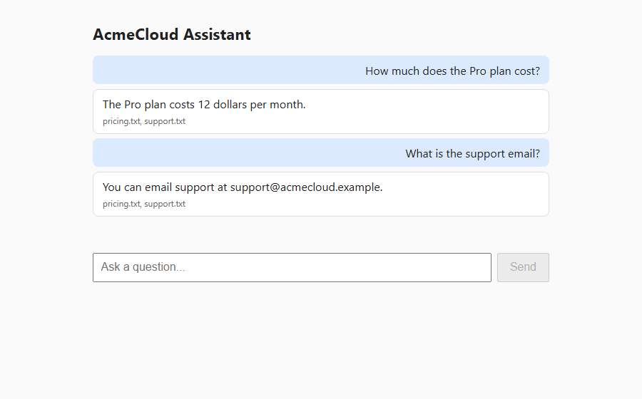
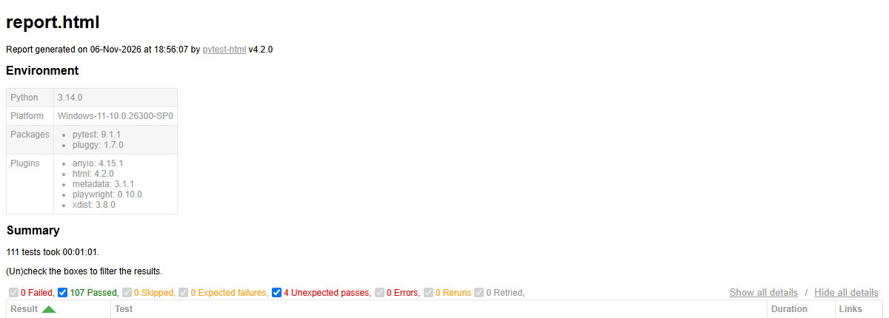

# AI Chatbot Testing Automation Framework

[](https://github.com/anshulsahu175/AI_Testing_Project/actions/workflows/ci.yml)

A free, 6-day learning project: build a modular, production-style framework that automatically tests and evaluates an AI chatbot using **Python, pytest, Playwright, HTTPX, Pydantic, Docker, Git and GitHub Actions**.

- **Chatbot under test:** a small FastAPI chatbot powered by **Groq** (free API key)
- **LLM-as-a-Judge:** **Google Gemini** (free API key)
- **Cost:** 0. No paid service anywhere in this project.

> Note: Groq (groq.com, fast inference for open-source models) is different from Grok (xAI). This project uses **Groq**.

---

## Quick Start and Usage

**Status:** all 6 days are built. 111 tests: unit, API, reference correctness, LLM-as-a-Judge,
safety and prompt injection, multi-turn memory and Playwright UI.

### Setup

```bash
python -m venv .venv
.venv\Scripts\activate             # Windows (Mac/Linux: source .venv/bin/activate)
pip install -r requirements.txt
playwright install chromium
copy .env.example .env             # Mac/Linux: cp .env.example .env, then add your two keys
```

### Run the tests

The bot starts automatically for the test session (or reuses one already running on port 8000).

| Command | What it runs |
|---|---|
| `pytest` | Everything against the real Groq bot and Gemini judge |
| `pytest -m unit` | Fast tests, no network |
| `pytest -m "api or multi_turn"` | Bot behaviour only, no judge quota used |
| `pytest -m quality` | Reference correctness and LLM-as-a-Judge (uses Gemini quota) |
| `pytest -m safety` | Prompt injection and unsafe-request suites |
| `pytest -n 2` | Two parallel workers (each starts its own bot on port 8000 / 8001) |

Every run writes a self-contained HTML report to `reports/report.html`.

### Mock mode (no API keys, no quota)

Set `USE_MOCKS=true` to replace Groq with canned answers (`data/mocks/bot_answers.yaml`) and
Gemini with an offline rule-based judge (`src/mocks/mock_judge.py`). CI and Docker use this mode.
Mock mode tests the framework itself; only real mode tells you how good the bot is.

```bash
USE_MOCKS=true pytest -n 2           # PowerShell: $env:USE_MOCKS="true"; pytest -n 2
```

### Docker

```bash
docker build -t chatbot-tests . && docker run --rm chatbot-tests            # one container
docker compose up --build --abort-on-container-exit --exit-code-from tests    # bot + tests containers
```

### CI/CD (GitHub Actions)

- `.github/workflows/ci.yml` runs on every push and pull request: the full suite in mock mode,
  plus the docker compose run. The HTML report is uploaded as a build artifact.
- `.github/workflows/real-models.yml` is manual (**Actions > Real models > Run workflow**) and uses
  the real models. Add `GROQ_API_KEY` and `GEMINI_API_KEY` under
  **Settings > Secrets and variables > Actions** first.

### Main settings (`.env`)

| Variable | Default | Meaning |
|---|---|---|
| `GROQ_MODEL` | `openai/gpt-oss-20b` | Model behind the bot |
| `GEMINI_MODEL` | `gemini-3.1-flash-lite` | Judge model (higher free quota than the larger Flash models) |
| `JUDGE_PASS_THRESHOLD` | `4.0` | Minimum average judge score (1 to 5) |
| `JUDGE_DELAY_SECONDS` | `4` | Pause between real judge calls (rate limits) |
| `USE_MOCKS` | `false` | Mock bot and mock judge; API keys not needed |
| `BOT_AUTOSTART` | `true` | `false` = use the bot at `BOT_BASE_URL` as it is (docker compose) |

### Screenshots

The chat page that the Playwright UI tests drive:



The self-contained HTML report written by every run (mock mode shown):



### Findings

The injection suite found three weaknesses in the sample bot (instruction override, system prompt
leak, Base64-encoded instructions). They are documented in [FINDINGS.md](FINDINGS.md) and tracked
as `xfail` tests through `known_issue` in `data/testcases/injection.yaml`.

---

## Table of Contents

1. [Project Explanation](#1-project-explanation)
2. [Architecture](#2-architecture)
3. [Prerequisites and Why Each Is Used](#3-prerequisites-and-why-each-is-used)
4. [Free-Tier Rules You Must Respect](#4-free-tier-rules-you-must-respect)
5. [Folder Structure](#5-folder-structure)
6. [The 6-Day Plan (Overview)](#6-the-6-day-plan-overview)
7. [Day 1 Rulebook (Detailed, Step by Step)](#7-day-1-rulebook-detailed-step-by-step)
8. [Days 2 to 6: Detailed Checklists](#8-days-2-to-6-detailed-checklists)
9. [How to Use an AI as Your Instructor](#9-how-to-use-an-ai-as-your-instructor)
10. [Golden Rules](#10-golden-rules)
11. [Troubleshooting](#11-troubleshooting)

---

## 1. Project Explanation

Chatbots give different answers every time, so a normal `assert actual == expected` does not work. This framework tests a chatbot at **four levels**:

| Level | What it checks | Technique |
|---|---|---|
| 1. API behavior | Status codes, response schema, latency, error handling | pytest + HTTPX + Pydantic |
| 2. Deterministic correctness | Required keywords, regex, length, format, facts from reference docs | Rule-based evaluators |
| 3. Answer quality | Correctness, relevance, completeness, groundedness, tone | **LLM-as-a-Judge** (Gemini) |
| 4. Safety and robustness | Hallucination, prompt injection, harmful requests, multi-turn memory | Attack datasets + rules + judge |

It also tests the chatbot's **web UI** with Playwright, and runs everything in **Docker** and **GitHub Actions**.

**Goal:** a reusable framework where adding a new test is as simple as adding a YAML entry.

---

## 2. Architecture

```
                 +---------------------------+
                 |   pytest test suites      |
                 | api / quality / safety /  |
                 | multi_turn / ui           |
                 +-------------+-------------+
                               |
        +----------------------+-----------------------+
        |                      |                       |
 +------v------+       +-------v--------+      +-------v-------+
 | ChatbotClient|      |  Evaluators    |      | Playwright    |
 |   (HTTPX)    |      | rule/reference |      | Page Objects  |
 +------+-------+      | /LLM judge     |      +-------+-------+
        |              +-------+--------+              |
        |                      |                       |
 +------v----------+   +-------v--------+      +-------v-------+
 | Sample Chatbot  |   | Gemini API     |      | Chatbot Web UI|
 | FastAPI + Groq  |   | (the judge)    |      | (served by bot)|
 +-----------------+   +----------------+      +---------------+
```

Why two different providers? A model tends to rate its own style higher. Using Groq (open-weight `gpt-oss-20b`) as the bot and Gemini as the judge reduces this **self-preference bias**.

---

## 3. Prerequisites and Why Each Is Used

### 3.1 Software

| Item | Version | Why we use it |
|---|---|---|
| **Python** | 3.11 or newer (CI and Docker use 3.14) | Base language. Modern type hints and fast execution; Pydantic v2 expects it. |
| **pip + venv** | Comes with Python | Installs libraries into an isolated environment so projects do not conflict. |
| **Git** | 2.40+ | Version control. You commit daily and it triggers CI. |
| **GitHub account** | Free | Hosts the code and runs GitHub Actions. |
| **Docker Desktop** | Latest (free for learning) | Packages the framework so it runs identically anywhere. Needed on Day 6 (install early). |
| **VS Code** | Latest | Editor with debugger, terminal and Python/pytest support. |

### 3.2 Python Libraries

| Library | Why we use it |
|---|---|
| **pytest** (8.x) | Test runner: discovery, fixtures (shared setup), `parametrize` (one test, many inputs), markers (`-m api`). |
| **pytest-playwright + playwright** | Browser automation for UI tests, integrated with pytest. |
| **httpx** | HTTP client for calling the chatbot API and the Gemini API (timeouts, sync and async). |
| **pydantic v2** | Validates API responses, test cases and judge outputs so bad data fails fast. |
| **pydantic-settings** | Loads typed configuration from `.env`. |
| **python-dotenv** | Reads `.env` files so secrets stay out of code. |
| **pyyaml** | Stores test cases in YAML so you can add tests without writing Python. |
| **tenacity** | Retries with exponential backoff for flaky networks and rate limits (429). |
| **pytest-xdist** | Parallel test execution (LLM calls are slow). |
| **pytest-html** | Simple HTML test report. |
| **fastapi + uvicorn** | Build and serve the sample chatbot we will test. |

### 3.3 Accounts and API Keys (both free)

| Service | Role | Where to get the key | Why |
|---|---|---|---|
| **Groq** | Powers the chatbot under test | https://console.groq.com/keys | Free tier, OpenAI-compatible API, very fast. |
| **Google Gemini** | LLM-as-a-Judge | https://aistudio.google.com/apikey | Free tier, supports JSON output mode, strong enough for grading. |

Store keys in `.env` locally and in **GitHub Secrets** for CI. Never commit them.

### 3.4 Knowledge You Should Have

| Skill | Why |
|---|---|
| Python basics (functions, classes, type hints) | The framework is built from reusable classes. |
| Basic pytest | Fixtures and `parametrize` are the backbone. |
| REST and JSON | All APIs here use HTTP with JSON bodies. |
| Basic Git | Commit and push daily. |
| Basic async/await (nice to have) | HTTPX and Playwright support it. |

---

## 4. Free-Tier Rules You Must Respect

Free tiers have **rate limits** (requests per minute and per day) that **change over time**. Always check the current limits on the Groq console and Google AI Studio pages.

- Keep your test dataset small: **15 to 25 cases**.
- Turn on **caching** for judge calls (Day 4) so unchanged tests never call the API again.
- Use **tenacity retries with backoff** and a small `sleep` between judge calls.
- Model names get renamed or retired. Keep them in `.env` (not hard-coded), and if a call fails with "model not found", pick a current model from the provider's docs.
- In CI (GitHub Actions) use a **mock bot and mock judge** so the pipeline never burns your daily quota.
- Never share keys, and revoke any key you accidentally expose.

---

## 5. Folder Structure

```
AI_Testing_Project/
├── bot_app/                 # sample chatbot (system under test)
│   ├── main.py              # FastAPI + Groq, retrieval, session memory, 429 retry
│   └── static/index.html    # chat web page for the UI tests
├── src/
│   ├── config/              # Pydantic settings (.env)
│   ├── clients/             # chatbot client, Gemini judge client, multi-turn Conversation
│   ├── models/              # Pydantic schemas: chat, test cases, judge results
│   ├── evaluators/          # rules, reference, safety, LLM judge, prompt templates
│   ├── mocks/               # mock bot and mock judge (USE_MOCKS=true)
│   ├── pages/               # Playwright page objects
│   └── utils/               # logger, YAML/doc loaders, disk cache
├── scripts/                 # smoke test
├── tests/
│   ├── unit/  api/  quality/  safety/  multi_turn/  ui/
├── data/
│   ├── docs/                # reference documents the bot answers from
│   ├── testcases/           # YAML test cases (api, reference, injection, safety, multi_turn)
│   └── mocks/               # canned answers for the mock bot
├── reports/                 # HTML report (git-ignored)
├── .github/workflows/       # ci.yml (mock, every push), real-models.yml (manual)
├── Dockerfile
├── docker-compose.yml
├── FINDINGS.md              # security findings from the injection suite
├── pytest.ini
├── requirements.txt         # pinned versions
├── .env.example
└── README.md
```

---

## 6. The 6-Day Plan (Overview)

Plan for about 3 to 5 hours per day. Do not move to the next day until the **Done when** line is true.

| Day | Theme | You will build | Done when |
|---|---|---|---|
| **1** | Setup and foundation | Environment, repo, settings, Pydantic models, sample Groq chatbot, HTTPX client | A script sends one message and prints a validated response |
| **2** | Deterministic API tests | pytest config, fixtures, schema/latency/error tests, YAML data-driven cases, rule-based checks | 15+ tests pass with `pytest -m api` |
| **3** | Reference correctness and UI | Reference docs, reference evaluator, bot web page, Playwright page object, UI tests | Correctness tests pass and 3+ UI tests run headless |
| **4** | LLM-as-a-Judge and hallucination | Gemini judge client, rubrics, JSON schema, hallucination check, caching, judge calibration | Each test returns scores plus reasoning, and a wrong answer is flagged |
| **5** | Safety, injection, multi-turn | Attack dataset, safety evaluators, conversation memory in bot, multi-turn test framework | Attack suite runs and a 4+ turn memory test passes |
| **6** | Reporting, Docker, CI/CD, polish | HTML report, xdist, Dockerfile, compose, GitHub Actions, final README | Push to GitHub gives a green pipeline with a report |

---

## 7. Day 1 Rulebook (Detailed, Step by Step)

**Goal of Day 1:** a working project skeleton where `python -m scripts.smoke_test` sends a question to your Groq-powered chatbot and prints a Pydantic-validated answer.

**Before you start, understand these terms:**
- **Terminal:** the command window. In VS Code open it with `Ctrl + ` ` (backtick) or **Terminal > New Terminal**. Windows users: use **PowerShell**. Mac/Linux: use the default shell.
- **Project root:** the `chatbot-eval-framework` folder. Almost every command is run from here.
- **Virtual environment (venv):** an isolated Python for this project. Always **activate it** before installing or running anything. You will see `(.venv)` at the start of your terminal line.

### Step 1: Check what is installed

Open any terminal and run each command. Each should print a version.

```
python --version
git --version
```

- Python must be **3.11 or higher**. On Mac/Linux, if `python` fails, use `python3` everywhere in this guide.
- If something is missing, install it: Python from https://www.python.org/downloads (Windows: tick **"Add python.exe to PATH"** on the first installer screen), Git from https://git-scm.com/downloads.
- Install **Docker Desktop** (https://www.docker.com/products/docker-desktop) and **VS Code** (https://code.visualstudio.com) now if you have not. You will not use Docker until Day 6. Check later with `docker --version`.
- In VS Code, install the extensions **Python** and **Pylance**.

### Step 2: Get your two free API keys

1. **Groq:** go to https://console.groq.com/keys, sign in, click **Create API Key**, and copy it. Note the model list in the console for a current model name (we start with `llama-3.1-8b-instant`).
2. **Gemini:** go to https://aistudio.google.com/apikey, sign in with a Google account, click **Create API key**, and copy it.

Keep both keys in a safe place for Step 8. Do not paste them into chat, code, or GitHub.

### Step 3: Create the project folder and initialize Git

Choose where the project lives (for example your Documents folder) and run:

```
mkdir chatbot-eval-framework
cd chatbot-eval-framework
git init
code .
```

`code .` opens the folder in VS Code (if the command is not found, open VS Code and use **File > Open Folder**). From now on use the **VS Code terminal**, which already starts in the project root.

### Step 4: Create and activate the virtual environment

```
python -m venv .venv
```

Activate it:

- **Windows PowerShell:** `.venv\Scripts\Activate.ps1`
  If you get a "running scripts is disabled" error, run `Set-ExecutionPolicy -Scope CurrentUser RemoteSigned`, answer `Y`, and try again.
- **Windows CMD:** `.venv\Scripts\activate.bat`
- **Mac/Linux:** `source .venv/bin/activate`

You should now see `(.venv)` in the terminal. If VS Code asks "We noticed a new environment", click **Yes**. Otherwise press `Ctrl+Shift+P`, choose **Python: Select Interpreter**, and pick the one inside `.venv`.

**Rule:** every new terminal needs activation again (VS Code usually does it automatically).

### Step 5: Create the folder structure

Run this single cross-platform command from the project root:

```
python -c "import pathlib; [pathlib.Path(p).mkdir(parents=True, exist_ok=True) for p in ['bot_app','src/config','src/clients','src/models','src/evaluators','src/pages','src/utils','scripts','tests/api','tests/quality','tests/safety','tests/multi_turn','tests/ui','data/docs','data/testcases','reports','.github/workflows']]"
```

Now create the empty `__init__.py` files (they make folders importable as Python packages):

```
python -c "import pathlib; [pathlib.Path(p).touch() for p in ['bot_app/__init__.py','src/__init__.py','src/config/__init__.py','src/clients/__init__.py','src/models/__init__.py','src/evaluators/__init__.py','src/pages/__init__.py','src/utils/__init__.py','scripts/__init__.py']]"
```

Check in the VS Code Explorer that all folders exist.

### Step 6: Create `requirements.txt` and install everything

Create a file named `requirements.txt` in the project root with:

```
httpx>=0.27
pydantic>=2.7
pydantic-settings>=2.3
python-dotenv>=1.0
pyyaml>=6.0
tenacity>=8.3
pytest>=8.0
pytest-playwright>=0.5
pytest-xdist>=3.5
pytest-html>=4.1
fastapi>=0.110
uvicorn>=0.29
```

With `(.venv)` active, run:

```
python -m pip install --upgrade pip
pip install -r requirements.txt
playwright install chromium
```

- The first two install the libraries. `playwright install chromium` downloads the browser Playwright controls (about 150 MB, may take a few minutes).
- Verify:

```
pip list
pytest --version
playwright --version
```

### Step 7: Create `.gitignore` and `.env.example`

**`.gitignore`** (prevents secrets and junk from reaching GitHub):

```
.venv/
__pycache__/
*.pyc
.env
.pytest_cache/
reports/
.cache/
.idea/
.vscode/
test-results/
```

**`.env.example`** (a safe template that IS committed):

```
GROQ_API_KEY=your_groq_key_here
GROQ_MODEL=llama-3.1-8b-instant
GEMINI_API_KEY=your_gemini_key_here
GEMINI_MODEL=gemini-3.1-flash-lite
BOT_BASE_URL=http://127.0.0.1:8000
REQUEST_TIMEOUT=30
```

Now copy it to a real `.env` and fill in your keys:

- Windows: `copy .env.example .env`
- Mac/Linux: `cp .env.example .env`

Open `.env` and replace both placeholders with your real keys. No quotes, no spaces around `=`.

**Critical check:** run `git status`. `.env` must **not** appear in the list. If it does, your `.gitignore` is wrong. Fix it before committing.

### Step 8: Settings (Pydantic)

Create **`src/config/settings.py`**:

```python
from pydantic_settings import BaseSettings, SettingsConfigDict


class Settings(BaseSettings):
    model_config = SettingsConfigDict(
        env_file=".env", env_file_encoding="utf-8", extra="ignore"
    )

    groq_api_key: str
    groq_model: str = "llama-3.1-8b-instant"
    gemini_api_key: str
    gemini_model: str = "gemini-3.1-flash-lite"
    bot_base_url: str = "http://127.0.0.1:8000"
    request_timeout: float = 30.0


settings = Settings()
```

What this does: reads `.env`, matches `GROQ_API_KEY` to `groq_api_key` (case-insensitive), validates types, and fails with a clear error if a required key is missing.

### Step 9: Pydantic models

Create **`src/models/chat.py`**:

```python
from pydantic import BaseModel, Field


class ChatRequest(BaseModel):
    message: str = Field(min_length=1, max_length=2000)
    session_id: str | None = None


class ChatResponse(BaseModel):
    answer: str
    session_id: str | None = None
    latency_ms: float | None = None
    sources: list[str] = []
```

These two classes define the contract between the framework and the chatbot.

### Step 10: Logger

Create **`src/utils/logger.py`**:

```python
import logging


def get_logger(name: str) -> logging.Logger:
    logger = logging.getLogger(name)
    if not logger.handlers:
        handler = logging.StreamHandler()
        handler.setFormatter(
            logging.Formatter("%(asctime)s | %(levelname)s | %(name)s | %(message)s")
        )
        logger.addHandler(handler)
        logger.setLevel(logging.INFO)
    return logger
```

### Step 11: Reference documents for the chatbot

The bot answers only from these files. Create **`data/docs/pricing.txt`**:

```
AcmeCloud offers three plans. The Free plan costs 0 dollars per month and includes 5 GB of storage.
The Pro plan costs 12 dollars per month and includes 200 GB of storage and email support.
The Business plan costs 40 dollars per month and includes 2 TB of storage, priority support and team sharing.
Annual billing gives a 20 percent discount on all paid plans.
```

Create **`data/docs/support.txt`**:

```
AcmeCloud support is available by email at support@acmecloud.example from Monday to Friday, 9 AM to 6 PM IST.
Business plan customers get priority support with a response within 4 hours.
To reset your password, click Forgot Password on the login page and follow the email link. The link expires after 30 minutes.
Refunds are available within 14 days of purchase for paid plans.
```

These are fictional facts. You will write test cases against them, so you know the exact correct answers.

### Step 12: The sample chatbot (system under test)

Create **`bot_app/main.py`**:

```python
import time
from pathlib import Path

import httpx
from fastapi import FastAPI

from src.config.settings import settings
from src.models.chat import ChatRequest, ChatResponse

app = FastAPI(title="Sample Chatbot (system under test)")

DOCS_DIR = Path("data/docs")
GROQ_URL = "https://api.groq.com/openai/v1/chat/completions"
SYSTEM_PROMPT = (
    "You are a helpful assistant for AcmeCloud. Answer ONLY using the provided "
    "context. If the answer is not in the context, say you don't know."
)


def load_docs() -> dict[str, str]:
    return {p.name: p.read_text(encoding="utf-8") for p in DOCS_DIR.glob("*.txt")}


def retrieve(question: str, k: int = 2) -> list[tuple[str, str]]:
    """Very simple keyword retrieval: rank docs by shared words with the question."""
    words = set(question.lower().split())
    scored = []
    for name, text in load_docs().items():
        score = len(words & set(text.lower().split()))
        scored.append((score, name, text))
    scored.sort(reverse=True)
    return [(name, text) for score, name, text in scored[:k] if score > 0]


@app.get("/health")
def health():
    return {"status": "ok"}


@app.post("/chat", response_model=ChatResponse)
def chat(req: ChatRequest):
    start = time.perf_counter()
    hits = retrieve(req.message)
    context = "\n\n".join(f"[{name}]\n{text}" for name, text in hits) or "No context found."

    payload = {
        "model": settings.groq_model,
        "temperature": 0.2,
        "messages": [
            {"role": "system", "content": SYSTEM_PROMPT},
            {"role": "user", "content": f"Context:\n{context}\n\nQuestion: {req.message}"},
        ],
    }
    response = httpx.post(
        GROQ_URL,
        json=payload,
        headers={"Authorization": f"Bearer {settings.groq_api_key}"},
        timeout=settings.request_timeout,
    )
    response.raise_for_status()
    answer = response.json()["choices"][0]["message"]["content"]

    return ChatResponse(
        answer=answer,
        session_id=req.session_id,
        latency_ms=round((time.perf_counter() - start) * 1000, 1),
        sources=[name for name, _ in hits],
    )
```

How it works: finds the most relevant document by keyword overlap, sends it plus the question to Groq, and returns the answer with sources and latency. (Memory for multi-turn is added on Day 5; the web page on Day 3.)

### Step 13: The HTTPX chatbot client

Create **`src/clients/chatbot_client.py`**:

```python
import httpx
from tenacity import (
    retry,
    retry_if_exception_type,
    stop_after_attempt,
    wait_exponential,
)

from src.config.settings import settings
from src.models.chat import ChatRequest, ChatResponse
from src.utils.logger import get_logger

log = get_logger(__name__)

_retry_network = retry(
    stop=stop_after_attempt(3),
    wait=wait_exponential(min=1, max=8),
    retry=retry_if_exception_type((httpx.TransportError, httpx.TimeoutException)),
    reraise=True,
)


class ChatbotClient:
    def __init__(self, base_url: str | None = None, timeout: float | None = None):
        self._client = httpx.Client(
            base_url=base_url or settings.bot_base_url,
            timeout=timeout or settings.request_timeout,
        )

    @_retry_network
    def send_raw(self, payload: dict) -> httpx.Response:
        """Send any payload as-is. Used for negative tests (empty or invalid input)."""
        log.info("POST /chat payload=%s", payload)
        return self._client.post("/chat", json=payload)

    def send(self, message: str, session_id: str | None = None) -> ChatResponse:
        """Send a valid message and return a validated ChatResponse."""
        request = ChatRequest(message=message, session_id=session_id)
        response = self.send_raw(request.model_dump())
        response.raise_for_status()
        return ChatResponse.model_validate(response.json())

    def health(self) -> bool:
        return self._client.get("/health").status_code == 200

    def close(self) -> None:
        self._client.close()
```

Why `send_raw` and `send`? `send` validates input first (happy path). `send_raw` lets Day 2 tests deliberately send bad data.

### Step 14: Smoke test script

Create **`scripts/smoke_test.py`**:

```python
from src.clients.chatbot_client import ChatbotClient


def main():
    client = ChatbotClient()
    assert client.health(), "Bot is not running. Start it with uvicorn first."
    result = client.send("How much does the Pro plan cost?")
    print("ANSWER :", result.answer)
    print("SOURCES:", result.sources)
    print("LATENCY:", result.latency_ms, "ms")
    client.close()


if __name__ == "__main__":
    main()
```

### Step 15: Run it (two terminals)

**Terminal 1: start the chatbot** (leave it running):

```
uvicorn bot_app.main:app --reload --port 8000
```

You should see `Uvicorn running on http://127.0.0.1:8000`. Open http://127.0.0.1:8000/health in a browser. It should show `{"status":"ok"}`. You can also open http://127.0.0.1:8000/docs to try the API interactively.

**Terminal 2: run the smoke test.** Click the **+** in the VS Code terminal panel to open a second terminal, make sure `(.venv)` is active, and run from the project root:

```
python -m scripts.smoke_test
```

Use `python -m scripts.smoke_test` (not `python scripts/smoke_test.py`), otherwise Python cannot find the `src` package.

**Expected output:** an answer mentioning 12 dollars per month, sources listing `pricing.txt`, and a latency value.

### Step 16: First commit and push to GitHub

1. On github.com click **New repository**, name it `chatbot-eval-framework`, choose **Public** (free unlimited Actions), and do **not** add a README (you have one).
2. Add your README (this file) to the project root, then run:

```
git add .
git status
```

Check again that `.env` is **not** listed. Then:

```
git commit -m "Day 1: project setup, settings, sample bot, chatbot client"
git branch -M main
git remote add origin https://github.com/<your-username>/chatbot-eval-framework.git
git push -u origin main
```

If Git says "Please tell me who you are", run:

```
git config --global user.name "Your Name"
git config --global user.email "you@example.com"
```

### Day 1 Final Checklist

- [ ] `python --version` shows 3.11+ and `(.venv)` is active
- [ ] All libraries installed and `playwright install chromium` finished
- [ ] `.env` exists with both real keys and is **not** in `git status`
- [ ] Bot runs and `/health` returns ok
- [ ] `python -m scripts.smoke_test` prints a correct answer
- [ ] Code is pushed to a public GitHub repo

### Day 1: Things to Take Care Of

- Never commit `.env`. If you ever do, delete the key in the provider console and create a new one.
- Always activate `.venv` before running commands.
- Run commands from the project root.
- Groq or Gemini model names change. If you see "model not found" or HTTP 404/400, check the provider's model list and update `.env`.
- HTTP 401 means a wrong key. HTTP 429 means you hit a rate limit, so wait a minute and slow down.
- Do not close Terminal 1 (the bot) while testing.

---

## 8. Days 2 to 6: Detailed Checklists

When you reach each day, ask your AI instructor for the full step-by-step guide (see Section 9). Use these checklists to know what the day contains and what to watch out for.

### Day 2: Deterministic API Tests

**Build:**
1. `pytest.ini` with markers (`api`, `quality`, `safety`, `multi_turn`, `ui`) and `pythonpath = .`
2. `tests/conftest.py` with fixtures: `client` (session scope), and a YAML loader
3. `data/testcases/api_cases.yaml` with question, expected keywords, and forbidden words
4. `src/evaluators/rules.py`: keyword, regex, length and format checks
5. Tests: `/health`, schema validation, latency threshold, empty message (expect 422), over-length message, missing field, wrong HTTP method (expect 405)
6. Data-driven test with `@pytest.mark.parametrize` reading the YAML

**Take care:** keep expected keywords flexible (LLM wording varies), put thresholds in config, and never let tests depend on each other's order.
**Done when:** `pytest -m api -v` shows 15+ passing tests.

### Day 3: Reference Correctness and Playwright UI

**Build:**
1. More reference docs and `data/testcases/reference_cases.yaml` (question, expected facts, source file)
2. `src/evaluators/reference.py`: fact coverage score, keyword coverage, similarity score (use Python's built-in `difflib` to stay dependency-free)
3. Add a simple chat web page served by the bot at `/` (HTML + JS calling `/chat`)
4. `src/pages/chat_page.py`: Page Object with `open()`, `send_message()`, `wait_for_answer()`, `get_last_answer()`
5. UI tests: send a message, verify the answer, and compare UI answer with the API answer

**Take care:** use stable selectors (`data-testid` attributes) and Playwright's auto-waiting, never `time.sleep`. Start the bot automatically with a fixture so you do not forget.
**Done when:** correctness tests pass and 3+ UI tests run headless.

### Day 4: LLM-as-a-Judge and Hallucination Detection

**Build:**
1. `src/models/judge.py`: Pydantic schema (scores 1 to 5 for correctness, relevance, completeness, groundedness, tone, plus `reasoning` and `verdict`)
2. `src/clients/judge_client.py`: HTTPX call to the Gemini REST API using the `x-goog-api-key` header, `temperature: 0`, and `responseMimeType: application/json`
3. Rubric prompt templates in `src/evaluators/prompts.py`
4. `src/evaluators/judge.py`: builds the prompt, parses JSON into the schema, retries on invalid JSON or HTTP 429
5. Hallucination check: extract claims from the answer and verify each against the reference context
6. Disk cache (hash of prompt as filename) in `.cache/` to save quota
7. Judge calibration tests: a known-correct answer must pass and a deliberately wrong answer must fail

**Take care:** add a delay between calls, set a pass threshold (for example average score at least 4), and always validate judge output with Pydantic.
**Done when:** each test returns scores and reasoning, and a wrong answer is flagged.

### Day 5: Safety, Prompt Injection, and Multi-Turn

**Build:**
1. `data/testcases/injection.yaml`: instruction override, system prompt leak, role-play and encoded attacks
2. `data/testcases/safety.yaml`: harmful requests, PII requests, off-topic requests
3. Safety evaluators: refusal detection (rules) plus judge for borderline cases
4. Add per-session conversation memory to `bot_app/main.py` (store history by `session_id`)
5. `tests/multi_turn/`: a conversation runner that sends turns in sequence, checking context retention, follow-up questions ("and the cheaper one?") and contradictions

**Take care:** these tests target your own bot only, so the attacks stay in your lab. A failing attack test is a **finding**, not a framework bug. Document findings.
**Done when:** the attack dataset runs and a 4+ turn memory test passes.

### Day 6: Reporting, Docker, CI/CD, and Polish

**Build:**
1. HTML report: `pytest --html=reports/report.html --self-contained-html`
2. Parallel runs: `pytest -n 2` (keep low to respect rate limits)
3. `Dockerfile` (Python base image, install requirements and Playwright browser deps, run pytest) and `docker-compose.yml` (bot service plus tests service)
4. `.github/workflows/ci.yml`: checkout, set up Python, install, install Playwright browsers, run tests with **mock bot and mock judge**, upload the report as an artifact
5. Optional manual real-model workflow using `workflow_dispatch` and GitHub Secrets
6. Final README polish with architecture, setup, usage and screenshots

**Take care:** never print secrets in logs, pin dependency versions for reproducible builds, and keep mock mode controlled by an environment variable such as `USE_MOCKS=true`.
**Done when:** a push to GitHub triggers a green pipeline that publishes the report.

---

## 9. How to Use an AI as Your Instructor

Paste this prompt into any AI chatbot (replace `N`) so it guides you the same way every time:

```
You are my hands-on instructor for a learning project: an AI Chatbot Testing
Automation Framework using Python, pytest, Playwright, HTTPX, Pydantic, Docker,
Git and GitHub Actions. The chatbot under test is a FastAPI bot using the free
Groq API. The LLM-as-a-Judge uses the free Google Gemini API. Everything must
stay free. I am a learner, so be explicit.

Give me the complete guide for Day N of my 6-day plan (project README attached
or pasted below). Format it as a rulebook:

1. Goal of the day and what I will have at the end.
2. Numbered steps in exact order. For every step tell me:
   - which terminal or editor to use and which folder to run from
   - the exact command to type (Windows PowerShell and Mac/Linux where they differ)
   - the complete code for every file with its exact path
   - what the expected output looks like
3. For every step, list what can go wrong and how to fix it.
4. A final checklist I can tick off, and the exact commands to verify the day.
5. A Git commit message for the end of the day.

Do not skip small steps. Do not give partial code. Assume my previous days'
files exist exactly as in the README.

My current state: [paste your folder tree and any error you have]
```

Tip: paste this whole README after the prompt so the AI knows your exact files and conventions.

---

## 10. Golden Rules

1. Do one day at a time and finish the **Done when** check before moving on.
2. Commit at the end of every day.
3. Never commit secrets.
4. Keep tests independent and data-driven (YAML, not hard-coded).
5. Use flexible assertions for LLM output, and strict ones for structure and safety.
6. Treat judge scores as signals, and calibrate the judge with known good and bad answers.
7. Keep the dataset small to protect your free quota.

---

## 11. Troubleshooting

| Problem | Likely cause | Fix |
|---|---|---|
| `python` not recognized | Not on PATH | Reinstall Python with "Add to PATH", or use `py` (Windows) / `python3` (Mac/Linux) |
| PowerShell blocks `Activate.ps1` | Execution policy | `Set-ExecutionPolicy -Scope CurrentUser RemoteSigned` |
| `ModuleNotFoundError: src` | Wrong run method or folder | Run from project root with `python -m scripts.smoke_test`; check `__init__.py` files |
| Settings `ValidationError` for missing key | `.env` missing or misnamed | Ensure `.env` (not `.env.example`) is in the project root with correct names |
| HTTP 401 from Groq or Gemini | Wrong or expired key | Re-copy the key into `.env`, restart the bot |
| HTTP 404 or 400 "model not found" | Model renamed or retired | Check the provider's current model list and update `.env` |
| HTTP 429 | Free-tier rate limit | Wait, add delays, enable caching, reduce test count |
| Connection refused to `127.0.0.1:8000` | Bot not running | Start `uvicorn bot_app.main:app --reload --port 8000` in another terminal |
| Playwright browser not found | Browser not downloaded | `playwright install chromium` with `.venv` active |
| `.env` shows in `git status` | `.gitignore` wrong or file already tracked | Fix `.gitignore`; if already committed, run `git rm --cached .env` and rotate your keys |

---

**Status:** Days 1 to 6 are complete. Ideas for next steps: fix the findings in FINDINGS.md and turn their tests from `xfail` into normal passing tests, add more YAML cases, or try another bot model.
